<p align="center">
  
</p>

<p align="center">
  
  
  
  
  
</p>

**Trinetra AI** answers questions from your own PDFs on Indian law (IPC), medicine and disaster management. Each PDF becomes a **knowledge graph** built with semantic chunking. The assistant keeps **short-term and long-term memory**, and answers stream in word by word. It runs two ways:

| | 🖥️ `app.py`: local | ☁️ `app2.py`: cloud |
|---|---|---|
| Answers written by | Mistral via **Ollama**, on your PC | **Google Gemini** API (`gemini-3.5-flash-lite`) |
| Needs | about 5 GB for the model, no API key | a Gemini API key |
| Best for | private, offline use | a public website on **Render** |

Both use the same chat UI, the same four domains, the same search and the same memory.

| Domain | Source folder |
|---|---|
| ⚖️ Legal & Constitutional | `semrag_project/data/IPC_docs/` |
| 🏥 Medical Information | `semrag_project/data/medical_docs/` |
| 🌊 Disaster Management | `semrag_project/data/disaster_docs/` |
| 🌐 All-in-One | every PDF under `semrag_project/data/` |

---

## See it in action

<p align="center">
  
</p>

The answer above is real output from `app2.py` for *"What is IPC Section 420?"*. Every sentence comes from `IPC.pdf`.

---

## How data flows

There are two phases. **Indexing** turns the PDFs into a searchable knowledge graph. **Answering** runs for every question.

### 1. Indexing

<p align="center">
  
</p>

1. **PDF files → text.** `load_pdf()` reads each PDF in the domain's folder, page by page, with `pypdf`.
2. **Text → semantic chunks.** [`semantic_chunk()`](semrag_project/src/chunking/semantic_chunker.py) embeds each sentence together with its neighbours using `all-MiniLM-L6-v2`. It starts a new chunk wherever the similarity between consecutive sentences drops below **0.75**, so each chunk holds one topic.
3. **Chunks → entity graph.** [`build_graph()`](semrag_project/src/graph/graph_builder.py) runs spaCy NER on each chunk. Every named entity (e.g. *Section 420*, *Diabetes*, *NDRF*) becomes a node, and entities found in the same chunk are linked by an edge that **stores the chunk text**.
4. **Graph → communities.** [`detect_communities()`](semrag_project/src/graph/community_detector.py) runs Louvain clustering, which groups entities that tend to appear together.
5. **Domain index.** The index is built at startup in `app.py`. For `app2.py`, `build_index.py` builds it once and saves it to `index_cache/`. Each PDF is chunked once; All-in-One reuses the chunks of the other domains.

### 2. Answering a question

<p align="center">
  
</p>

1. **Browser → Flask.** The chat UI sends `POST /api/ask/stream` with `{system, question, session_id}`.
2. **Memory commands first.** *"remember …"*, *"forget …"* and *"what do you remember?"* are answered directly from `memory.db`, without calling the LLM.
3. **Local search** returns up to 6 passages. The search uses the question together with the previous one, so follow-ups such as *"How is it treated?"* still find the right topic.
   - **Graph (top 3):** entities similar to the question (above **0.5**) score the chunks they appear in. Specific entities count more than generic ones (IDF weighting), so *"Section 420"*, which appears in 2 chunks, outranks *"IPC"*, which appears in 31.
   - **Direct (top 3):** the chunks most similar to the question itself. These catch passages whose entities are too generic to match, such as *"Symptoms"*.
4. **Global search.** The question is compared with each community, and the entity names of the **top 3 communities** add broader topic context.
5. **Prompt.** [`build_prompt()`](semrag_project/src/llm/answer_generator.py) combines the identity (*Trinetra AI, developed by Vansh Sharma*), the domain rules, the passages, the memory facts, the chat history and the question.
6. **LLM → browser.** Ollama (`app.py`) or Gemini (`app2.py`) writes the answer. Flask relays each token as a Server-Sent Event (`data: {"token": "…"}`), so the answer appears as it is written.
7. **Saving.** The question and answer are saved to `memory.db`. The first question becomes the chat's title in the sidebar.

### 3. Memory: short-term + long-term

<p align="center">
  
</p>

| | Short-term memory | Long-term memory |
|---|---|---|
| What | the last 6 messages of this chat | facts you told it to remember |
| Scope | one chat | every chat, every domain |
| Stored in | `memory.db` (chats survive restarts) | `memory.db` |
| Code | `get_chat_context()` in `app.py` / `app2.py` | [`memory_store.py`](semrag_project/src/memory/memory_store.py) |

| You type | What happens |
|---|---|
| `remember my name is Arjun and I am a law student` | saved; every future answer can use it |
| `what do you remember?` | lists all saved facts |
| `forget Arjun` | deletes facts containing "Arjun" |
| `forget everything` | clears long-term memory |

The sidebar's **🧠 Long-term memory** panel lists every fact, and you can delete one with **×**. Questions such as *"do you remember my name?"* are not treated as commands; the LLM answers them from memory.

---

## Quick start: local (`app.py`)

**Requirements:** Python 3.10+, [Ollama](https://ollama.com), and about 5 GB of disk space.

```powershell
cd semrag_project

# 1. Python environment
python -m venv .venv
.venv\Scripts\python -m pip install -r requirements.txt
.venv\Scripts\python -m spacy download en_core_web_sm

# 2. Local LLM (Ollama keeps running in the background)
winget install Ollama.Ollama
ollama pull mistral

# 3. Run
.venv\Scripts\python app.py
```

Open **http://127.0.0.1:5000**. All domains are ready about a minute after startup.

> **`ImportError: cannot import name 'is_offline_mode' from 'huggingface_hub'`?** Another package in your global Python (e.g. `yolov5`) has pinned an old `huggingface_hub`. Create the venv with `python -m venv --system-site-packages .venv` and install only `"huggingface_hub>=1.5,<2"` into it.

---

## Deploy to Render (`app2.py`)

<p align="center">
  
</p>

`app2.py` is the same app built for a small server. Two things change:
- **Gemini writes the answers,** about one API call per question.
- **The index is built once on your PC** by `build_index.py`. The server loads it from `index_cache/` in about 2 seconds and runs the same MiniLM embeddings through ONNX (`fastembed`) instead of PyTorch. It uses **about 200 MB of RAM**, which fits Render's free 512 MB.

1. **Get a Gemini API key** at [aistudio.google.com/apikey](https://aistudio.google.com/apikey). Put it in `semrag_project/.env` (see [`.env.example`](semrag_project/.env.example)):
   ```
   GEMINI_API_KEY=your-key
   ```
   `.env` is in [`.gitignore`](.gitignore). **Never commit the key.**
2. **Build the index** whenever your PDFs change. This takes under a minute and makes no API calls:
   ```powershell
   cd semrag_project
   .venv\Scripts\python build_index.py
   ```
3. **Try it locally:** run `.venv\Scripts\python app2.py`, then open http://127.0.0.1:5001.
4. **Push** the code and `index_cache/` to GitHub.
5. **On Render:** choose **New → Blueprint**, pick this repository, and paste your key when it asks for `GEMINI_API_KEY`. Everything else comes from [`render.yaml`](render.yaml):

   | Setting | Value |
   |---|---|
   | Root directory | `semrag_project` |
   | Build command | `pip install -r requirements-render.txt` (also downloads the embedding model) |
   | Start command | `gunicorn app2:app --workers 1 --threads 8 --timeout 180 --bind 0.0.0.0:$PORT` |

> ⚠️ **Free plan notes:**
> - Render wipes the disk on every restart and redeploy, so chats and memory reset.
> - The service sleeps after 15 minutes without visitors.
> - Every visitor shares your free Gemini quota. Each one is limited to 15 questions per minute and 300 per day (`ASK_RATE_LIMIT`).

---

## Configuration

| Variable | Default | Purpose |
|---|---|---|
| `OLLAMA_MODEL` | `mistral` | `app.py`: any pulled Ollama model, e.g. `llama3.2:3b` |
| `GEMINI_API_KEY` | (none) | `app2.py`: Google Gemini API key |
| `GEMINI_MODEL` | `gemini-3.5-flash-lite` | `app2.py`: chat model |
| `ASK_RATE_LIMIT` | `15 per minute;300 per day` | `app2.py`: questions per visitor |
| `PORT` | `5001` | `app2.py`: port (Render sets it) |
| `DATA_DIR` | `semrag_project/data` | folder with the domain folders |
| `MEMORY_DB` | `semrag_project/memory.db` | chats + long-term memory |
| `ASSISTANT_NAME` / `ASSISTANT_CREATOR` | `Trinetra AI` / `Vansh Sharma` | how the assistant introduces itself |

## API

| Method & path | Purpose |
|---|---|
| `GET /` | chat UI |
| `POST /api/ask/stream` | ask a question; streams Server-Sent Events |
| `POST /api/ask` | same, as JSON with the retrieved passages |
| `GET` / `POST /api/sessions/<system>` | list chats / start a chat |
| `GET` / `DELETE /api/sessions/<system>/<id>` | read / delete a chat |
| `GET` / `POST /api/memory`, `DELETE /api/memory/<id>` | long-term memory facts |
| `GET /api/status/<system>`, `GET /health` | index and LLM status |

## Project layout

```
MULTIMODEL-RAG-SYSTEM/
├── README.md                      # this file
├── render.yaml                    # Render Blueprint for app2.py
├── .gitignore                     # keeps .env, .venv/ and model downloads out of git
└── semrag_project/
    ├── app.py                     # local server: Ollama + index built at startup
    ├── app2.py                    # cloud server: Gemini + prebuilt index_cache/
    ├── build_index.py             # builds index_cache/ for app2.py
    ├── index_cache/               # chunks, graph, communities + MiniLM vectors (~2 MB)
    ├── templates/index.html       # Trinetra AI chat UI
    ├── data/                      # your PDFs, one folder per domain
    ├── docs/                      # animated diagrams + make_diagrams.py that generates them
    ├── requirements.txt           # full local dependencies
    ├── requirements-render.txt    # lightweight server dependencies
    ├── .env.example               # template for .env (GEMINI_API_KEY)
    ├── README.md                  # project-level details
    └── src/
        ├── chunking/              # semantic chunker
        ├── graph/                 # entity extraction, graph, communities
        ├── retrieval/             # local + global search (app.py)
        ├── cloud/                 # Gemini client, ONNX embedder, prebuilt index search (app2.py)
        ├── llm/                   # prompt + Ollama client
        └── memory/                # long-term memory + saved chats (SQLite)
```

The diagrams are generated from code. After changing one in [`make_diagrams.py`](semrag_project/docs/make_diagrams.py), regenerate them all with `python semrag_project/docs/make_diagrams.py`.

## Limitations

- **Memory is shared.** There are no user accounts, so every visitor sees the same long-term facts.
- **Answers are only as good as the retrieved passages.** Passages about neighbouring topics can sometimes leak into an answer.
- **`app.py` rebuilds its index on every start,** which takes about a minute. `app2.py` loads its prebuilt index in seconds.

---

<p align="center">Developed with ❤️ by <strong>Vansh Sharma</strong></p>
